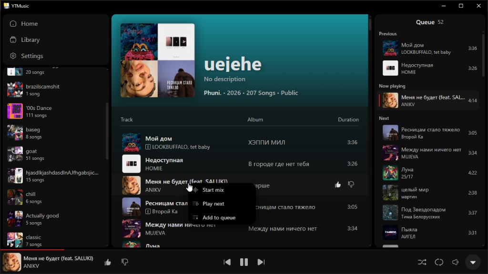
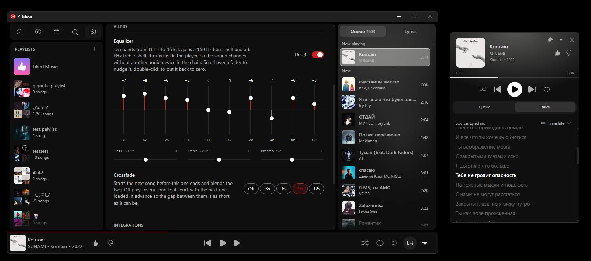

# YTMusic

A Windows desktop client for [YouTube Music](https://music.youtube.com). Sign in with your account, browse home, playlists, albums, and artists, and play from a queue that stays in sync with the hardware media keys.

<p align="center">
  
</p>

<p align="center">
  
</p>

## Download

Grab the latest version from the [Releases page](https://github.com/sndell/yt-music-app/releases). Each release is a single `YTMusic.exe` (onefile) for Windows 10 or later with the [WebView2 runtime](https://developer.microsoft.com/microsoft-edge/webview2/).

## Features

- Home shelves of songs, albums, and playlists, tinted from the cover art
- Playlist, album, and artist pages, with your playlists listed in the sidebar
- Playback of the song's own audio stream: seek, volume, shuffle, and repeat. A Premium account plays YouTube Music's high-quality stream, about 256 kbps, when that file is offered
- A queue with what already played, what is playing, and what is next
- Queue styles: pick a style (All, Workout, Party, Focus, ...) to retune the up-next list without interrupting the current song
- Drag to reorder the queue, and reorder tracks in your own playlists
- Track actions: start a mix, play next, or add to the queue
- An audio equalizer: ten bands, a 150 Hz bass and a 6 kHz treble shelf, and a manual preamp, running inside the player
- A crossfade that starts the next song N seconds before this one ends, preloading it so the hand-over costs no network
- An always-on-top popout player: a small frameless window with the queue, lyrics and related songs while the main window stays in the background
- Like and dislike, written back to your YouTube Music account
- Pages paint from cache instantly, then refresh in the background
- Discord Rich Presence for the song that is playing
- Windows media keys for play, pause, next, and previous, including when the window is in the background

## Requirements

- Windows 10 or later, with the [WebView2 runtime](https://developer.microsoft.com/microsoft-edge/webview2/) (already present on current Windows 11)
- [Python 3.15](https://www.python.org/downloads/)
- [Node.js](https://nodejs.org/) and [pnpm](https://pnpm.io/)

## Run in development

Install the UI dependencies and create the Python environment once:

```powershell
cd ui
pnpm install
cd ..\app
python -m venv .venv
.\.venv\Scripts\python.exe -m pip install -r requirements.txt
```

From the repo root, start the window:

```powershell
.\start.ps1
```

`start.ps1` runs `app/main.py`. In dev that process picks a free port, starts the Vite server on it in its own console window, and opens the webview at `http://localhost:<port>`, so there is no second terminal to run. The port is printed in the Python terminal, and each run gets its own, so several checkouts can run at the same time. Closing the window stops Vite too. A frozen build serves the packaged `ui/dist` instead and starts no server.

Sign in from **Settings**. The app opens YouTube Music, waits until you are logged in, and stores the request it needs. Auth, the WebView2 profile, and the cache stay in the `app` folder while you are developing.

## Build

From the repo root:

```powershell
.\build\build.ps1
```

That typechecks the UI, builds it with the base path the packaged page needs, and runs PyInstaller. The result is `build\dist\<yyyy-MM-dd_HHmm>\YTMusic.exe`. Each build keeps its own folder.

The exe has no console. Logs go to `%LOCALAPPDATA%\YTMusic\ytmusic.log`. The WebView2 profile, auth file, and cache live in that same folder.

## Layout

| Path | What it is |
| --- | --- |
| `start.ps1` | Starts the window; the Python process starts the Vite server for dev |
| `app/` | The desktop window, YouTube Music API, and Windows media keys |
| `docs/screenshot.png` | README image |
| `ui/` | The React interface (Vite, TypeScript, Tailwind) |
| `build/build.ps1` | UI build plus the onefile exe |
| `build/YTMusic.spec` | PyInstaller spec used by the build script |
| `build/dist/` | Dated onefile builds. Older folders are left in place |

YTMusic is an independent client. It is not affiliated with YouTube or Google.

